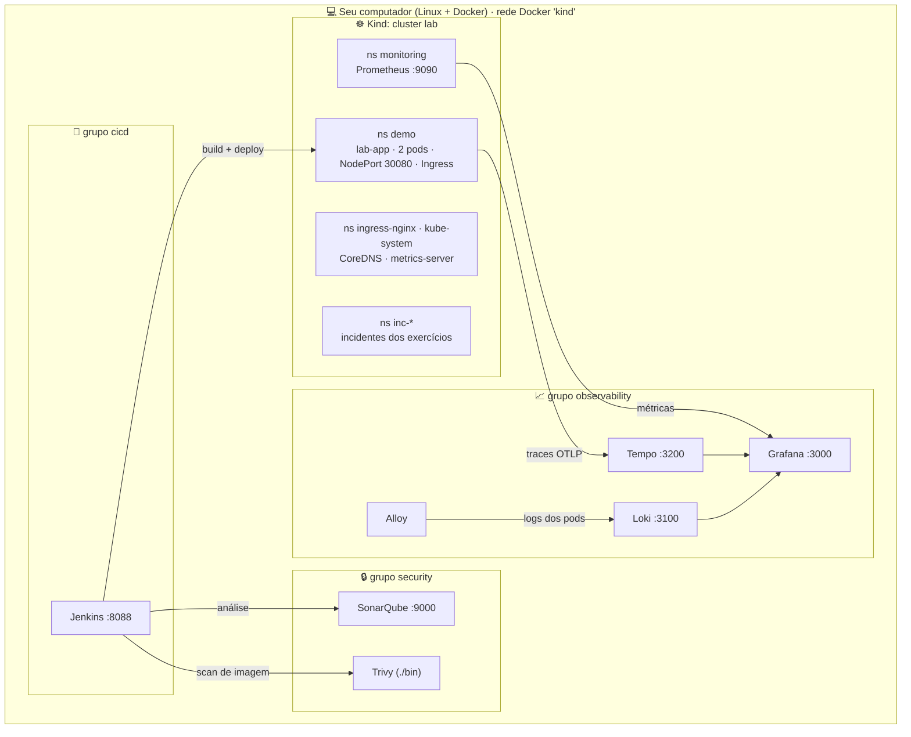

<div align="center">

# 🧪 DevOps Lab

**Laboratório local e gratuito de DevOps / SRE / Cloud**
Kubernetes · Observabilidade · CI/CD · Terraform · Segurança


</div>

> Sem conta em nenhum serviço, sem cartão, sem nuvem. Tudo roda no seu computador (Docker + Kind).

## 📑 Índice

- [Visão geral](#-visão-geral)
- [Arquitetura](#-arquitetura)
- [Pré-requisitos](#-pré-requisitos)
- [Como iniciar](#-como-iniciar)
- [Como verificar](#-como-verificar-se-está-tudo-funcionando)
- [Como parar](#-como-parar)
- [Roteiro de estudo](#-roteiro-de-estudo-um-dia)
- [Estrutura de diretórios](#-estrutura-de-diretórios)
- [Limitações conhecidas](#-limitações-conhecidas)

## 🎯 Visão geral

| | |
|---|---|
| **Temas** | Linux, Kubernetes/AKS, troubleshooting, CI/CD (Jenkins), Terraform, observabilidade (Golden Signals), segurança/qualidade (SonarQube, Trivy, Snyk) e conceitos AWS/Azure |
| **Exercícios** | 16 cenários de incidente isolados e reversíveis (`./lab.sh exercise list`) |
| **Internet** | Só na **instalação** (binários, imagens, banco de CVEs, providers Terraform, pacotes pip). Depois tudo funciona offline. Veja [docs/01-INSTALLATION.md](docs/01-INSTALLATION.md) |
| **Recursos** | Nada sobe sozinho: você inicia **um grupo por vez**, porque a RAM é o recurso mais escasso |

**Ferramentas (todas open source):** Docker Engine + Compose · Kind · kubectl · Terraform · Jenkins LTS · Prometheus · Grafana · Loki · Tempo · OpenTelemetry · Grafana Alloy · SonarQube Community Build · Trivy · Python/Flask (app demo).

## 🏗️ Arquitetura



Todos os containers usam a rede Docker `kind`, então se enxergam por nome (`lab-loki`, `lab-sonarqube`, `lab-control-plane`).

| Grupo | Serviços | Portas | RAM aprox. |
|---|---|---|---|
| `k8s` | Kind, app demo, Prometheus, ingress | 8080/8443 · 30080 · 9090 | ~1,5 GB |
| `observability` | Grafana, Loki, Tempo, Alloy | 3000 · 3100 · 3200 | ~0,7 GB |
| `cicd` | Jenkins | 8088 | ~1,2 GB |
| `security` | SonarQube (+ Trivy local) | 9000 | ~2,5 GB |

## ✅ Pré-requisitos

KDE Neon (Ubuntu 24.04), 16 GB RAM, ~25 GB livres em disco e usuário no grupo `docker`. Verifique tudo com:

```bash
./lab.sh check
```

## 🚀 Como iniciar

```bash
./lab.sh check                    # diagnóstico
./lab.sh install                  # baixa kind/kubectl/trivy em ./bin e o banco de CVEs (sem sudo)
./lab.sh install --apt            # opcional: htop, traceroute (pede sua senha sudo)
./lab.sh start k8s                # 1º: cluster + app demo + Prometheus (~3-5 min na 1ª vez)
./lab.sh start observability      # Grafana/Loki/Tempo (~1 min)
./lab.sh start cicd               # Jenkins (build da imagem ~3 min na 1ª vez)
./lab.sh start security           # SonarQube (~2-3 min) e depois ./lab.sh sonar-setup
```

> 💡 Para estudar Kubernetes e troubleshooting basta o grupo **k8s** (+ **observability** para Golden Signals).
> Se faltar RAM: `LAB_NODES=1 ./lab.sh start k8s` (cluster de 1 node) e suba `security` só quando for estudar Sonar.

<details>
<summary>📸 <b>Capturas: subindo o lab</b></summary>
<br>


</details>

## 🔍 Como verificar se está tudo funcionando

```bash
./lab.sh status
curl -s http://127.0.0.1:30080/info                        # app
curl -s http://127.0.0.1:9090/-/ready                      # Prometheus
curl -s http://127.0.0.1:3000/api/health                   # Grafana
./lab.sh urls                                              # todos os endereços e credenciais locais
```

<details>
<summary>📸 <b>Capturas: verificação</b></summary>
<br>


</details>

## 🛑 Como parar

```bash
./lab.sh stop observability       # ou: k8s | cicd | security | all   (não apaga nada)
./lab.sh status
./lab.sh reset                    # volta o namespace demo ao padrão e remove incidentes (pede confirmação)
./lab.sh cleanup                  # apaga cluster e containers (pede confirmação); --volumes também apaga dados
```

<details>
<summary>📸 <b>Capturas: parando e limpando</b></summary>
<br>


</details>

## 📚 Roteiro de estudo (um dia)

| Hora | Tema | Documento | Exercícios |
|---|---|---|---|
| 1h | 🐧 Linux e redes | [02](docs/02-LINUX-AND-NETWORKING.md) | `linux-cpu`, `linux-disk`, `linux-port`, `linux-dns` |
| 1h30 | ☸️ Kubernetes/kubectl | [03](docs/03-KUBERNETES.md) | leia + rode os comandos no ns `demo` |
| 1h30 | 🩺 Troubleshooting de pods | [08](docs/08-INCIDENTS-RCA.md) | `kubernetes-crashloop`, `oomkilled`, `imagepull-backoff`, `pending-pod`, `service-no-endpoints`, `dns-failure`, `rollback` |
| 1h | 🔁 Jenkins / CI-CD | [05](docs/05-JENKINS-CICD.md) | `pipeline run`, `jenkins-pipeline-fail` |
| 45min | 🏗️ Terraform | [04](docs/04-TERRAFORM.md) | `./lab.sh tf 01 ...` e `tf 02 ...` |
| 1h | 📈 Observabilidade e Golden Signals | [06](docs/06-OBSERVABILITY-DATADOG.md) | `http-500`, `high-latency`, `high-cpu` |
| 45min | 🔒 SonarQube / Trivy / Snyk | [07](docs/07-SECURITY-QUALITY.md) | `vulnerable-image`, `scan sonar-sample` |
| 30min | ☁️ AWS e Azure | [09](docs/09-CLOUD-AWS-AZURE.md) | leitura (tabelas comparativas) |

## 🗂️ Estrutura de diretórios

```
lab.sh                  script principal (./lab.sh help)
app/                    app Flask demo, testes, Dockerfile, Jenkinsfile, sonar-project.properties
k8s/base/               manifests do app (namespace, config, deployment, service, ingress)
k8s/addons/             Prometheus, metrics-server e ingress-nginx (versões fixas)
kind/                   configuração do cluster Kind
observability/          compose + configs de Grafana (dashboard Golden Signals), Loki, Tempo, Alloy
cicd/                   Jenkins (Dockerfile, plugins, Configuration as Code) + compose
security/               compose do SonarQube + samples/vulnerable-app (inseguro de propósito)
terraform/              01-local-basics (sem cluster) e 02-kubernetes (no Kind)
exercises/<nome>/       run.sh (reproduce|fix|validate|reset) + exercise.md (roteiro completo)
scripts/                lib.sh e gerador do doc 08
docs/                   documentação 01 a 10
bin/ e .data/           binários e estado local (ignorados pelo Git)
```

## ⚠️ Limitações conhecidas

- **Datadog / SonarCloud / Snyk** exigem conta: não são executados. Equivalentes locais: Grafana + Prometheus + Loki + Tempo, SonarQube e Trivy. As diferenças estão em [06](docs/06-OBSERVABILITY-DATADOG.md) e [07](docs/07-SECURITY-QUALITY.md).
- **AKS/EKS/AWS/Azure** não são provisionados; [09](docs/09-CLOUD-AWS-AZURE.md) e a seção Kind×AKS do [03](docs/03-KUBERNETES.md) fazem a ponte conceitual.
- Instalação e o **primeiro** `build` precisam de internet (Docker Hub, PyPI, GitHub, registry.terraform.io, banco do Trivy). Depois ficam em cache.
- Alertas são avaliados pelo Prometheus (sem Alertmanager, para poupar RAM): veja em http://127.0.0.1:9090/alerts.
- Jenkins monta o `docker.sock` do host (equivale a root): aceitável só neste lab local.
- O Jenkins usa um repositório git local (`.data/app-repo`) em vez de GitHub, para não depender de conta/rede.
- Pode ser necessário `sudo` apenas para instalar `htop`/`traceroute` (opcional).
- Ingress-NGINX foi aposentado pelo projeto Kubernetes em 2026 (sem novas versões); continua funcional para estudo e o conceito (Ingress + controller) é o mesmo.

---

Problemas? Veja [docs/10-LAB-TROUBLESHOOTING.md](docs/10-LAB-TROUBLESHOOTING.md).
